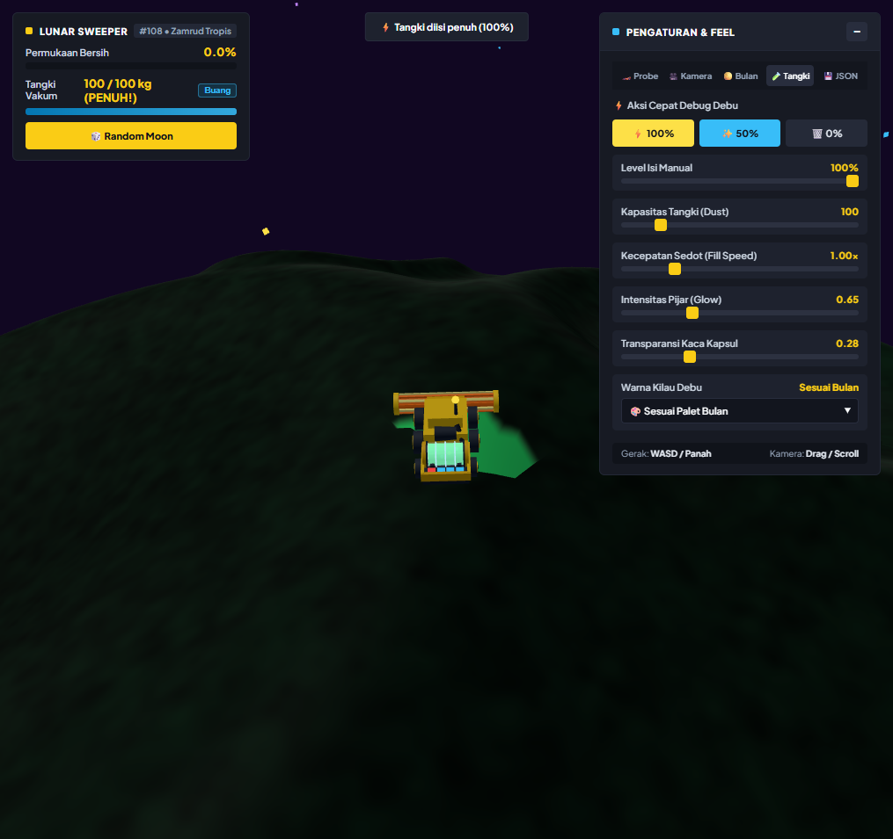

# 🌕 Lunar Sweeper 3D (Codename: Moon)

> Commercial-grade 3D stylized web game for Poki / WebGL, built with **Three.js**, **TypeScript**, and **Vite**.



---

## ✨ Features

- 🏎️ **Chibi Stylized Lunar Probe:**
  - Responsive arcade physics with dynamic throttle, reverse, and drift steering.
  - Multi-layered chibi wheels with yellow velg hubcaps and center axle nuts (zero Z-fighting).
  - Frontend sweeper roller and articulated trailer cart.

- 🧪 **Horizontal Vacuum Stardust Tank:**
  - Horizontal crystal-clear glass capsule tank mounted across the trailer cart.
  - Left-to-right radiant stardust fill animation with razor-sharp sliding floater meniscus.
  - 25%, 50%, and 75% vertical calibration tick rings.
  - Top-facing 4-segment meter on the cart bed for top-down camera views.

- 🛋️ **Comfort Camera Mode (Anti-Pusing):**
  - Smooth spherical coordinate tracking that eliminates disorienting roll and violent pitch flips.
  - Real-time controls for distance, height, pitch angle, field of view (FOV), and damping smoothness.

- 🌕 **Dynamic Spherical Moons:**
  - Procedural procedural moon generation with varied crater depths and sizes.
  - Rich variety of celestial color palettes and space skybox presets (Voyager, Nebula, Solar Horizon, Black Hole, etc.).

- 🛠️ **Realtime In-Game Tuning Panel:**
  - Tabbed HUD panel (`🏎️ Probe`, `🎥 Kamera`, `🌕 Bulan`, `🧪 Tangki`, `💾 JSON`).
  - Instant debug buttons for the vacuum tank (100%, 50%, 0%) and custom stardust glow color styles.
  - One-click JSON export/import and browser localStorage persistence.

---

## 🚀 Getting Started

### Prerequisites
- Node.js (v18 or higher recommended)
- npm

### Installation & Development
```bash
# Clone the repository
git clone https://github.com/AjiNurhakim/lunar-sweeper-3d.git

# Navigate to project directory
cd lunar-sweeper-3d

# Install dependencies
npm install

# Start local dev server
npm run dev
```

Open `http://localhost:3000` in your web browser.

### Production Build
```bash
npm run build
npm run preview
```

---

## 🎮 Controls

| Action | Controls |
|---|---|
| **Drive / Throttle** | `W` / `Up Arrow` |
| **Brake / Reverse** | `S` / `Down Arrow` |
| **Steer** | `A` / `D` or `Left` / `Right Arrow` |
| **Dump Vacuum Tank** | `E` or click **Buang** button |
| **Orbit Camera** | Click + Drag mouse |
| **Zoom** | Mouse Scroll wheel |
| **Toggle Tuning Panel** | Click `⚙️ PENGATURAN & FEEL` (Top Right) |

---

## 📄 License
MIT License. Created by **Aji Nurhakim**.
