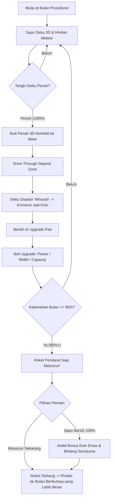

# GAME DESIGN DOCUMENT (GDD)
## Project: Lunar Sweeper 3D
**Target Platform:** Web (Poki Portal — Desktop & Mobile Responsive)  
**Genre:** 3D Arcade-Idle / Satisfying Surface Cleaner  
**Engine & Tech:** Three.js + TypeScript + Vite + Howler.js + Poki SDK  
**Document Status:** Version 1.0 (Live Document — Updated iteratively)  
**Last Updated:** November 2026  

---

## 1. Executive Summary & Vision

### 1.1 High Concept
**Lunar Sweeper 3D** adalah game *satisfying arcade-idle* 3D di mana pemain mengemudikan rover penjelajah kuning di permukaan bulat bulan-bulan luar angkasa, menyapu berbagai jenis debu kosmik tebal, menyetorkannya ke landasan roket, meng-upgrade performa rover, dan meluncur antar-bulan prosedural yang semakin besar dan menantang.

### 1.2 Core Pillars
1. **Satisfying Kinetic Cleaning (ASMR Feel)**: Sensasi mengupas lapisan kotoran tebal secara fisik dari permukaan bola 3D dengan sikat putar dan partikel debu berpendar yang memuaskan.
2. **Arcade-Idle Micro Loop**: Siklus adiktif: *Sapu Debu -> Tangki Penuh -> Setor ke Base ('Whoosh!') -> Koin -> Upgrade -> Kembali Menyapu Lebih Cepat*.
3. **Procedural Infinite Moons**: Petualangan tanpa akhir ke bulan-bulan prosedural yang skalanya semakin masif dengan lapisan debu berkekuatan tinggi dan rintangan meteor.
4. **Accessible Instant Web Experience**: Kontrol intuitif instan (WASD di PC, Dynamic Floating Joystick di HP), loading kilat (< 3 detik), 60 FPS stabil di mobile.

---

## 2. Core Gameplay Mechanics

### 2.1 The Rover & Sweeper
- **Movement Physics**: Bergerak mulus di sepanjang lingkaran besar (*great circle*) permukaan bola 3D. Orientasi rover otomatis menyesuaikan kemiringan kontur kawah menggunakan *surface normal sampling*.
- **Rotating Front Cylindrical Brush**: Rol sikat berputar di depan sasis rover yang secara fisik menyapu dan mengikis ketinggian lapisan debu.
- **Glowing Dust Tank (Backpack Canister)**:
  - Tabung silinder transparan di bagian belakang rover.
  - Saat debu disapu, tabung terisi partikel debu menyala secara real-time.
  - **Full Tank Threshold**: Ketika mencapai 100%, sikat otomatis berhenti menyapu, indikator visual *"TANK FULL"* berkedip, dan panah navigasi 3D memandu pemain kembali ke Base Station.
- **Tire Trails**: Roda meninggalkan tapak bertekanan di permukaan bulan yang memberikan kepuasan visual jelajah.

### 2.2 Dust Resistance & Multi-Tier Dust
Dalam satu bulan, terdapat **2 hingga 3 jenis debu** yang dibedakan berdasarkan warna dan kekuatannya:
1. **Tier 1 (Light Regolith)**: Debu tipis/berwarna terang. Mudah disapu, hampir tidak memperlambat laju rover. Nilai koin: rendah.
2. **Tier 2 (Medium Cosmic Dust)**: Debu sedang/berwarna pekat. Memerlukan daya sikat lebih tinggi. Memberikan efek perlambatan (*drag/friction*) sedang jika *Sweeper Power* rover masih rendah. Nilai koin: sedang.
3. **Tier 3 (Dense Stardust / Heavy Mud)**: Lapisan debu berat/berwarna gelap atau kontras. Jika *Sweeper Power* rover belum memadai, kecepatan rover akan drop drastis (*slowdown penalty*) saat menerobosnya. Nilai koin: tinggi.

### 2.3 Environmental Obstacles & Discoveries
- **Meteorite Boulders (Batu Meteor)**: Rintangan fisik statis bertebaran di permukaan bulan. Pemain harus menyetir meliuk-liuk di sekitarnya untuk membersihkan debu di celah-celah batu.
- **Deep Impact Craters**: Kawah terjal dengan dinding curam yang menguji kemampuan bermanuver rover.
- **Buried Relics (Hidden Discoveries)**:
  - Tertimbun di bawah tumpukan debu tebal: *Satelit Rusak, Jejak Kaki Apollo, Fosil Kristal Alien, dan Bendera Misi*.
  - Saat debu di atasnya bersih 100%, relik berpendar dan memberikan jackpot koin besar serta partikel kembang api kosmik.

---

## 3. Game Loop & Economy

### 3.1 Base Station & Deposit System
- **Lander Rocket**: Roket penjelajah yang mendarat di kutub awal bulan.
- **Drive-Through Deposit Ring**: Area lingkaran bercahaya di dekat roket.
  - Pemain cukup mengendarai rover melintasi lingkaran ini.
  - Debu di dalam tangki otomatis tersedot keluar dalam animasi spiral cepat menuju roket disertai efek audio vacuum "whoosh".
  - Counter koin bertambah secara dinamis sesuai jumlah dan tier debu yang disetor.

### 3.2 Upgrade Tree (Base Station Pads)
Di samping roket pendarat terdapat pad interaktif untuk upgrade:
1. **Sweeper Power**:
   - Menambah kekuatan sikat untuk mengikis debu lebih cepat.
   - Mengurangi / menghilangkan penalti pelambatan (*drag*) saat menerobos debu tebal Tier 2 & Tier 3.
2. **Sweeper Width**:
   - Memperpanjang ukuran silinder sikat di depan mobil, memperlebar radius sapuan sekali jalan.
3. **Tank Capacity**:
   - Meningkatkan daya tampung tabung debu (misal: 100 -> 250 -> 500 -> 1.000 unit debu) sehingga rover bisa menjelajah lebih lama sebelum harus kembali ke Base.

---

## 4. World & Level Progression

### 4.1 Procedural Infinite Moons
Tidak ada batasan jumlah level. Setiap kali roket meluncur, sistem membuat bulan prosedural baru dengan parameter skala yang terus meningkat:
- **Scaling Metric**:
  - `Moon Scale`: Radius bulan membesar secara bertahap (membutuhkan area jelajah lebih luas).
  - `Crater Density & Depth`: Jumlah dan kedalaman kawah bertambah.
  - `Dust Tier Distribution`: Persentase debu Tier 2 dan Tier 3 semakin dominan.
  - `Obstacle Frequency`: Jumlah bongkahan batu meteor meningkat.
  - `Coin Multiplier`: Penghasilan koin per butir debu meningkat sebanding dengan tingkat kesulitan.

### 4.2 Victory & Launch Milestone
- **85% Launch Threshold**: Saat permukaan bulan mencapai 85.0% bersih, roket membunyikan klakson peluncuran, mesin roket menyala berpendar, dan tombol *"LAUNCH TO NEXT MOON"* aktif.
- **100% Perfect Clean Bonus**: Pemain yang perfeksionis dan membersihkan hingga 100.0% mendapatkan trofi koin emas ekstra besar sebelum meluncur.

---

## 5. Controls & User Interface (UI/UX)

### 5.1 Controls Specification
- **Desktop (PC / Chromebook / Mac)**:
  - `W` / `Arrow Up`: Gas Maju
  - `S` / `Arrow Down`: Mundur
  - `A` / `Arrow Left`: Belok Kiri
  - `D` / `Arrow Right`: Belok Kanan
  - Mouse Drag: Orbit kamera bebas (opsional; kamera default auto-follow di belakang rover)
  - Mouse Wheel: Zoom in / Zoom out kamera
- **Mobile (Touch / Tablet)**:
  - **Dynamic Floating Joystick**: Menyentuh dan menyeret jari di mana saja pada layar memunculkan analog joystick responsif.
  - Rover berbelok dan melaju proporsional sesuai arah tarikan joystick.

### 5.2 UI Design System (Clean Boxy Minimalist — Based on Moon Creator Reference)
- **Aesthetic**: Flat, modern minimalis kotak-kotak persis seperti *Moon Generator 3D*, zero blur, zero heavy shadows, sudut rounded halus (4px - 6px), font *Plus Jakarta Sans*.
- **Color Palette**:
  - Dark Containers: `#171A23`, `#1E222E`, `#252A38`
  - Accent Color: Solar Yellow (`#FACC15`) & Soft Lavender Periwinkle (`#A5B4FC`)
  - Info / Secondary: Sky Blue (`#38BDF8`)
  - Clean / Victory: Emerald Green (`#4ADE80`)
  - Text: Clean Slate (`#F8FAFC` & `#94A3B8`)
- **HUD Layout**:
  - **Kiri Atas**: Badge Level Bulan (contoh: `MOON #4 • NEON PURPLE`) & Progress Bar Kebersihan (`42.5% / 85%`).
  - **Tengah Bawah**: Dust Tank Capacity Gauge (`75 / 150 DUST`).
  - **Kanan Atas**: Moon Credits / Coins & Tombol Toggle Audio (SFX & Musik).
  - **In-World 3D Nav Arrow**: Panah penunjuk arah bercahaya di atas rover yang selalu menunjuk ke arah roket pendarat saat tangki penuh atau saat roket siap luncur.

---

## 6. Monetization & Poki SDK Integration

### 6.1 Interstitial Ads (Commercial Break)
- **Trigger**: Ditampilkan **sesekali dan hanya saat transisi pergantian level** (ketika pemain menekan tombol meluncur ke bulan baru).
- **Rules**: Tidak pernah muncul di tengah-tengah pemain sedang menyapu atau berkendara. Dibatasi interval aman (minimal 3–4 menit antar ad).

### 6.2 Rewarded Ads (Pilihan Pemain)
Pemain dapat secara sukarela menonton video iklan pendek untuk mendapatkan keuntungan instan:
1. **Free Upgrade Bypass**: Upgrade stat rover (Power, Width, atau Tank) secara gratis tanpa memotong koin saat koin tidak mencukupi.
2. **Temporary Speed Boost**: Kecepatan akselerasi dan top speed rover meningkat 2x lipat selama 60 detik.
3. **Temporary Sweeper Width**: Lebar sikat sweeper membesar raksasa selama 60 detik.
4. **Exclusive Rover Skins**: Membuka kosmetik skin rover (misal: *Golden Apollo, Neon Cyber, Space Police*).

---

## 7. Art & Audio Direction

### 7.1 Visual Direction & Shading (Based on Moon Creator 3D)
- **Clay / Pastel Matte Shading**: Menggunakan *wrap-diffuse* lembut ($w = 0.55$) dengan *ambient occlusion* kawah, *tinted shadow* bernuansa pastel (tanpa bayangan hitam pekat), *satin sheen specular* pada bibir kawah, dan *fresnel rim glow*.
- **Lively Rover Animations & Smooth Physics**: Mengadopsi sistem suspensi 4 tapak roda ($h_{\text{FL}}, h_{\text{FR}}, h_{\text{BL}}, h_{\text{BR}}$) dan *camera up-vector lerp* dari `lunar_sweeper_3d_moon_cleaning_game (1).html` untuk pergerakan probe yang super halus tanpa guncangan gimbal lock.
- **Atmospheric Space Scenery**: Latar luar angkasa dengan bintang geometris *Octahedron*, awan nebula transparan berlayer *Icosahedron*, serta planet-planet cincin dan matahari raksasa di kejauhan.
- **Rich Dust Feedback**: Partikel debu kartun meletup lembut di samping sikat saat menyapu.

### 7.2 Audio Direction (ASMR & Cozy Vibe)
- **Sweeper Sound (Core Loop)**: Suara sedot vakum / sikat mekanis berfrekuensi empuk (ASMR feel) yang bersuara saat rover melintasi debu.
- **Deposit Whoosh**: Suara aliran partikel tersedot kencang ke dalam roket disusul gemerincing koin bertambah.
- **Ding / Chime Milestones**: Bunyi denting kristal setiap kali progress kebersihan naik 25%, 50%, 75%, 85%, dan 100%.
- **Background Music**: Musik ambient space chill / cozy synthwave bertempo santai yang tidak membuat jenuh saat sesi bermain lama.

---

## 8. Data Persistence (Save System)
Menggunakan `localStorage` browser pemain secara otomatis:
- `currentMoonIndex`: Level bulan saat ini.
- `coins`: Total saldo koin yang dimiliki.
- `upgrades`: Level upgrade untuk Power, Width, dan Tank.
- `unlockedSkins` & `activeSkin`: Data skin yang dimiliki.
- `audioSettings`: Preferensi mute sound/music.
- Game otomatis menyimpan setiap kali setor debu, beli upgrade, atau meluncur ke bulan berikutnya. Pemain yang menutup tab dan kembali besok tidak akan kehilangan progres.
